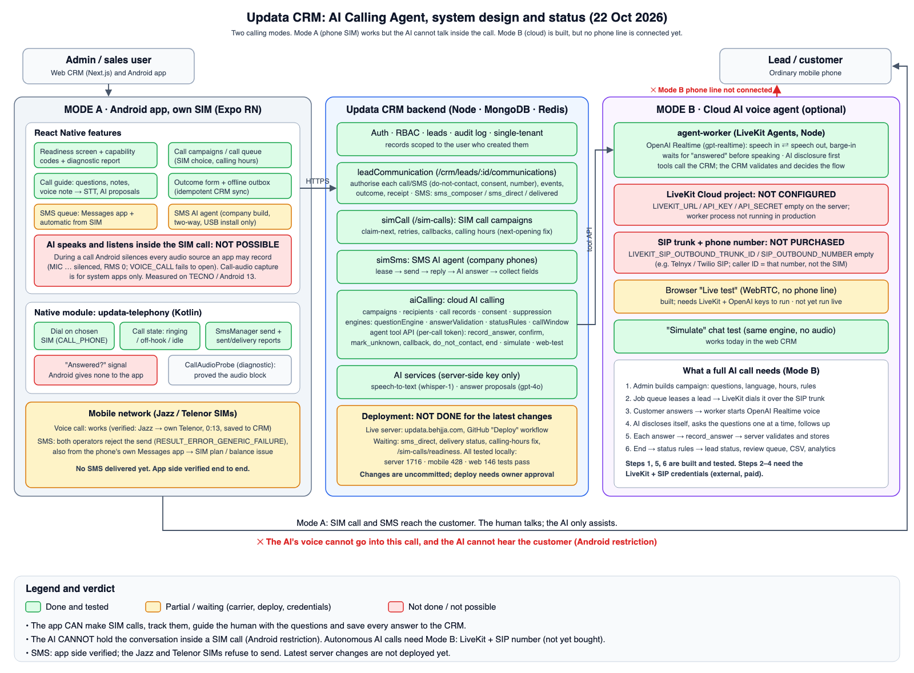
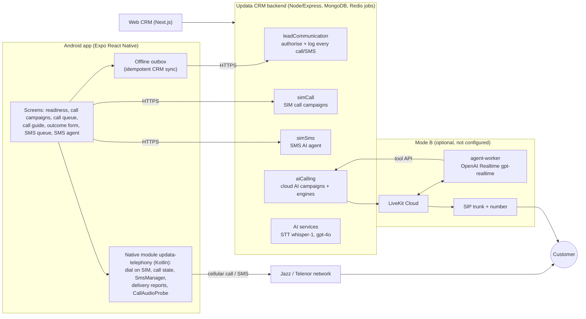
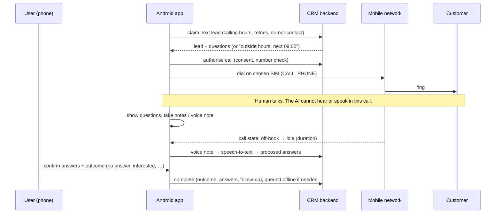
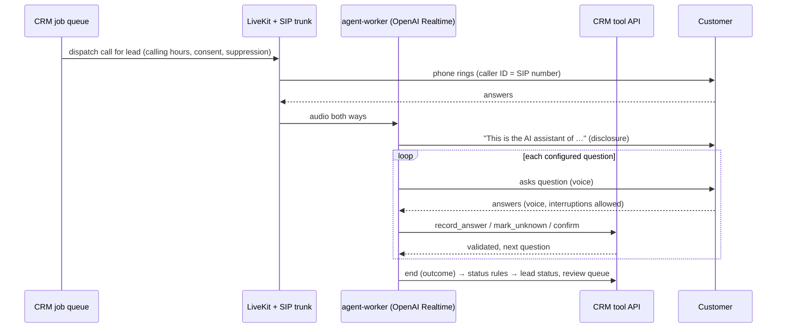

# Updata CRM: AI Calling Agent system design and status report

**Date:** 22 October 2026
**Scope:** Android app (SIM calling and SMS), Updata CRM backend, web CRM, and the optional cloud AI voice agent
**Test device:** TECNO KJ5, Android 13, dual SIM (Jazz + Telenor)
**App version:** 0.1.6 (versionCode 7)

*(Vector version: [ai-calling-system-design.svg](ai-calling-system-design.svg))*

---

## 1. Summary

| Question | Answer |
|---|---|
| Can the app make calls? | **Yes.** It calls from the phone's own SIM, on the SIM you choose, and the result is saved in the CRM. Verified on the TECNO. |
| Can the AI talk with the customer during a SIM call? | **No.** Android does not let an app hear or speak into an ordinary cellular call (measured on the device, see §5). |
| Can the AI collect the information during a SIM call? | **Partly (AI-assisted).** The app shows the questions to the human caller, transcribes voice notes, proposes answers, and saves them to the CRM. A human does the talking. |
| Can a fully automatic AI call (AI speaks, listens, asks, saves) work at all? | **Yes, but only in cloud mode (Mode B).** The software is built. It needs a LiveKit project and a SIP phone number, which have not been purchased or configured yet. |
| Does SMS work? | **App side yes, delivery no.** The app sends and logs SMS correctly. Both SIM operators (Jazz, Telenor) refuse to send SMS from this phone, also from the phone's own Messages app. |
| Is it live? | **Not yet.** The latest server changes are not deployed and the code is not yet committed. |

---

## 2. Architecture overview

There are two separate calling modes. They share the CRM backend but never replace each other silently.

| | Mode A: phone SIM (Android app) | Mode B: cloud AI voice agent (optional) |
|---|---|---|
| Who talks to the customer | The human user | The AI (OpenAI Realtime voice) |
| Caller ID | The user's own SIM number | The purchased SIP number |
| Needs | Android phone with SIM, app installed | LiveKit Cloud project, SIP trunk + number, agent-worker process, OpenAI key |
| Cost | The SIM's normal call/SMS tariff | LiveKit + SIP minutes + OpenAI Realtime usage |
| Status | Working (AI-assisted) | Built and tested in software; **not connected to a phone line** |

### 2.1 Components

### 2.2 Where the code lives

| Area | Path |
|---|---|
| Android app | `mobile/` (Expo SDK 57, React Navigation, TanStack Query, zustand) |
| Native telephony | `mobile/modules/updata-telephony/android/…/updatatelephony/` |
| SIM call campaigns (app) | `mobile/src/features/callCampaign`, `callQueue`, `communication` |
| SMS queue / SMS agent (app) | `mobile/src/features/smsQueue`, `smsAgent` |
| Readiness screen | `mobile/src/features/readiness` |
| Call/SMS authorisation and log | `server/src/modules/crm/leadCommunication.*` |
| SIM call campaigns (server) | `server/src/modules/simCall` |
| SMS AI agent (server) | `server/src/modules/simSms` |
| Cloud AI calling (server) | `server/src/modules/aiCalling` (engines, providers, tool API) |
| Cloud voice worker | `server/agent-worker` (LiveKit Agents + OpenAI Realtime) |
| Web CRM | `client/src/modules/aiCalling`, `client/src/modules/simCalls`, `client/src/modules/leads` |

---

## 3. How each flow works

### 3.1 Mode A: SIM call campaign (AI-assisted)

### 3.2 Mode A: SMS queue ("Text leads from your phone")

1. The user picks leads and writes a message with `{name}` and `{city}`. Unknown placeholders and empty values are warned about before sending.
2. **Messages mode** (every build): the phone's Messages app opens with the text, the user taps Send and confirms whether it went.
3. **Automatic mode** (client and company builds):
   - The user confirms, then the app sends from the chosen SIM, one SMS every 6 seconds, and can be stopped.
   - The CRM authorises each SMS first: do-not-contact, consent, and number checks.
   - The phone reports *sent* or *failed* with the network's error code.
   - The carrier's *delivery report* is sent to the CRM later, even if the app was closed.
4. Leads texted from this phone in the last 12 hours start skipped (they can be included). Failed messages do not count.

### 3.3 Mode A: SMS AI agent (company phones only)

The server leases a message, the phone sends it from its SIM, and replies are read by the app. The server's AI then answers and collects the configured fields. This needs SMS receive/read permissions, which Play Protect blocks for sideloaded apps. That is why it ships only in the company build, installed over USB.

### 3.4 Mode B: fully automatic AI call (cloud)

**Built and tested:**
- campaign builder (questions, language, hours, rules);
- question engine (follow-ups, conditional questions, confirmation);
- answer validation ("I don't know" is stored as unknown, never invented);
- status rules (incomplete calls go to human review, never auto-qualified);
- do-not-contact;
- per-call tool tokens;
- idempotent results;
- CSV export, live call monitor, human review screen;
- "Simulate" chat test.

**Not running:** steps that need LiveKit + SIP (dialing, live audio).

---

## 4. What is DONE (with evidence)

| # | Feature | Status | Evidence |
|---|---|---|---|
| 1 | Call from the phone's SIM, choose SIM 1 / SIM 2 | ✅ Done | TECNO 22 Oct: Jazz → own Telenor number placed |
| 2 | Detect call end and duration | ✅ Done | "Call ended · 0:13 off-hook" shown, stored in CRM |
| 3 | Save outcome + answers to the CRM (offline-safe, no duplicates) | ✅ Done | CRM record `telecom_direct` / `no_answer`, receipt "Saved in CRM" |
| 4 | SIM call campaigns: lead list, order, retries, callbacks, pause/resume | ✅ Done | Device runs 20–22 Oct; server tests |
| 5 | Calling hours with time zone + correct "next opening" | ✅ Done (test server) | Device showed "09:00–23:30 (Asia/Karachi) · Next 22 Oct 09:00", nothing dialled |
| 6 | Questions shown during the call, notes, voice note → text, AI answer proposals | ✅ Done | Earlier device runs; tests |
| 7 | Readiness screen (SIM, permissions, server, AI, limits, capability codes, diagnostic report) | ✅ Done | Device 21–22 Oct; 19 tests |
| 8 | SMS via the Messages app | ✅ Done | Device: composer opened, `user_reported_not_sent` logged |
| 9 | Automatic SMS from the SIM: authorise, send, error code, CRM log | ✅ Done (app side) | Device: CRM authorised, SIM attempted, network error shown and logged as `device_failed` |
| 10 | SMS delivery report to CRM (`device_delivered`) | ✅ Done (tests) | Server 28 + mobile tests; needs a working SIM to see on device |
| 11 | Multipart SMS, per-SIM sending, duplicate-send protection | ✅ Done | Native journal sends each id once; tests |
| 12 | Do-not-contact / consent / suppression checks before every call and SMS | ✅ Done | API tests (e.g. SMS suppressed → refused) |
| 13 | Cloud AI agent software (worker, engines, tool API, web wizard, review, export) | ✅ Built | Server tests; "Simulate" works in the web CRM |
| 14 | Security: no API keys in the APK, HTTPS only, backups off, token in secure storage | ✅ Done | Release-APK scan 22 Oct |
| 15 | Signed release APKs (client + company) | ✅ Done | `Updata-Client-0.1.6.apk`, signed with the same release key as previous versions |
| 16 | Automated tests | ✅ Pass | Server 1716 · mobile 428 · web 146 |

---

## 5. What is NOT done, and why

### 5.1 The AI cannot talk or listen inside a SIM call: **not possible on Android**

**Measured on the TECNO, Android 13**, with the app's built-in call audio check, during a live SIM call:

| Audio source | Result |
|---|---|
| MIC, VOICE_COMMUNICATION, VOICE_RECOGNITION, UNPROCESSED, CAMCORDER | Opened, but **silenced by Android** (`clientSilenced=true`, level 0) |
| VOICE_CALL, VOICE_UPLINK, VOICE_DOWNLINK | **Fail to open** (need a system-only permission) |
| Playing AI audio into the call | No supported path; loudspeaker routing is unreliable and not allowed as a substitute |

**Why:**
- Since Android 10, only system apps with `CAPTURE_AUDIO_OUTPUT` (signature/privileged) can record call audio.
- Becoming the default dialer does not grant this.
- Accessibility-service capture, speakerphone loopback and hidden APIs are unreliable, break Google Play policy, and were excluded on purpose.

**Result:** in Mode A, the AI *assists* the human but cannot be the voice on the call. A fully automatic AI conversation needs Mode B.

### 5.2 "Did the customer answer?" cannot be detected on a SIM call

Android tells a normal app only *ringing → off-hook → idle*. It does not report whether the other side picked up. The app therefore never claims "answered": the user chooses the outcome.

### 5.3 Fully automatic AI calls (Mode B): blocked on external accounts

| Missing | Why it is needed | Who |
|---|---|---|
| LiveKit Cloud project (URL, API key, secret) | Carries the call audio between the phone network and the AI | Owner: create account |
| SIP trunk + phone number (e.g. Telnyx or Twilio SIP) | Connects LiveKit to the real phone network; this is the caller ID | Owner: purchase |
| agent-worker running on the server | Runs the OpenAI Realtime voice agent | Deploy after the two above |
| A real end-to-end test call | Proves the AI hears the customer and the customer hears the AI | After setup |

Until then, Mode B can only be tested with **Simulate** (text chat, same engine). The **browser Live test** is built but also needs the LiveKit keys.

### 5.4 SMS is not delivered: carrier problem

- Both SIMs were tested, from the app and from the phone's own Messages app. The network refuses every send (`RESULT_ERROR_GENERIC_FAILURE`; Telenor IMS 500, Jazz RP-ERROR).
- This points to the SIM plan (no SMS bundle or balance) or the operator. It is not the app: the app's part is verified end to end.
- **To fix:** check the SMS package or balance with Jazz/Telenor until one normal SMS goes out from Messages, then the app test can be repeated.

### 5.5 Not deployed / not yet released

| Item | Status | Reason |
|---|---|---|
| Server changes: automatic SMS route, delivery status, calling-hours fix, readiness API | Not live | Not committed or deployed yet; deployment needs the owner's approval |
| Effect on the live app until deploy | Automatic SMS is refused by the live server; the old "Next:" time is shown | The live server runs older code |
| Client APK with SMS permission vs Google Play Protect | Not tested | Must be installed on a client phone via WhatsApp to check |
| Re-run of the call audio test on 22 Oct | Not done | The phone was disconnected from USB |
| Google Play Store release | Not started | SMS permissions require a Play policy declaration; the company build cannot go on Play |
| Legal review (AI call disclosure, consent, recording rules per country) | Not done | Needs a lawyer; the app already discloses the AI and records consent |

---

## 6. Data collected per call

| Data | Mode A (SIM) | Mode B (cloud) |
|---|---|---|
| Lead, user, campaign, attempt number | ✅ | ✅ |
| SIM used / caller ID | ✅ SIM slot | ✅ SIP number |
| Start, end, duration | ✅ (from call state) | ✅ (from SIP) |
| Answered / not answered | ❌ user enters it (Android limit) | ✅ from SIP |
| Answers to questions (validated, "unknown" allowed) | ✅ entered/confirmed by user | ✅ collected by AI, validated by server |
| Transcript / recording | ❌ not possible | Only if enabled and consented |
| Outcome, follow-up, lead status change, do-not-contact | ✅ | ✅ (status rules + human review) |
| Audit trail, idempotent sync | ✅ | ✅ |

---

## 7. Options to get "AI talks to the customer"

| Option | Works? | Notes |
|---|---|---|
| A. Ordinary app on the user's SIM | ❌ | Android blocks call audio (§5.1) |
| B. Cloud mode: LiveKit + SIP number + OpenAI Realtime | ✅ **Recommended** | Built; needs accounts and a number. Caller ID is the SIP number, not the user's SIM |
| C. Custom Android system image / rooted phone with privileged permission | Technically possible, not acceptable | Not distributable, against Play policy, voids device security |
| D. Speakerphone + microphone trick | ❌ | Echo, poor quality, other people hear the call; excluded as unreliable and non-compliant |

---

## 8. Next steps (in order)

1. **Approve commit and deploy** of the server changes (GitHub "Deploy" workflow), then verify the live server.
2. **Fix SMS on a SIM:** get one normal SMS through from the Messages app (Jazz or Telenor package/balance), then re-test automatic SMS and the delivery report.
3. **Install `Updata-Client-0.1.6.apk` on a client phone via WhatsApp** and check Play Protect.
4. **Reconnect the TECNO** to re-run the call audio check and test 0.1.6 on the device.
5. **Decide on Mode B.** If automatic AI calls are required:
   - create a LiveKit Cloud project;
   - buy a SIP trunk and number;
   - set `LIVEKIT_*`, `LIVEKIT_SIP_OUTBOUND_TRUNK_ID`, `SIP_OUTBOUND_NUMBER` and `OPENAI_API_KEY` on the server;
   - run `server/agent-worker`;
   - make one test call to an own number.
6. Legal review of AI disclosure, consent and calling hours for each target country.

---

## 9. Reference

- Detailed engineering log and evidence: `LEAD-VOICE-CALLING.md` (§0.1 call-audio measurement, §0.16 SIM-first app, §0.17 SMS queue + calling hours, §0.18 audit)
- Release APKs: Desktop `Updata-Client-0.1.6.apk` (clients) and `Updata-company-phones-USB-only/Updata-0.1.6-COMPANY-PHONES-USB-INSTALL-ONLY.apk`
