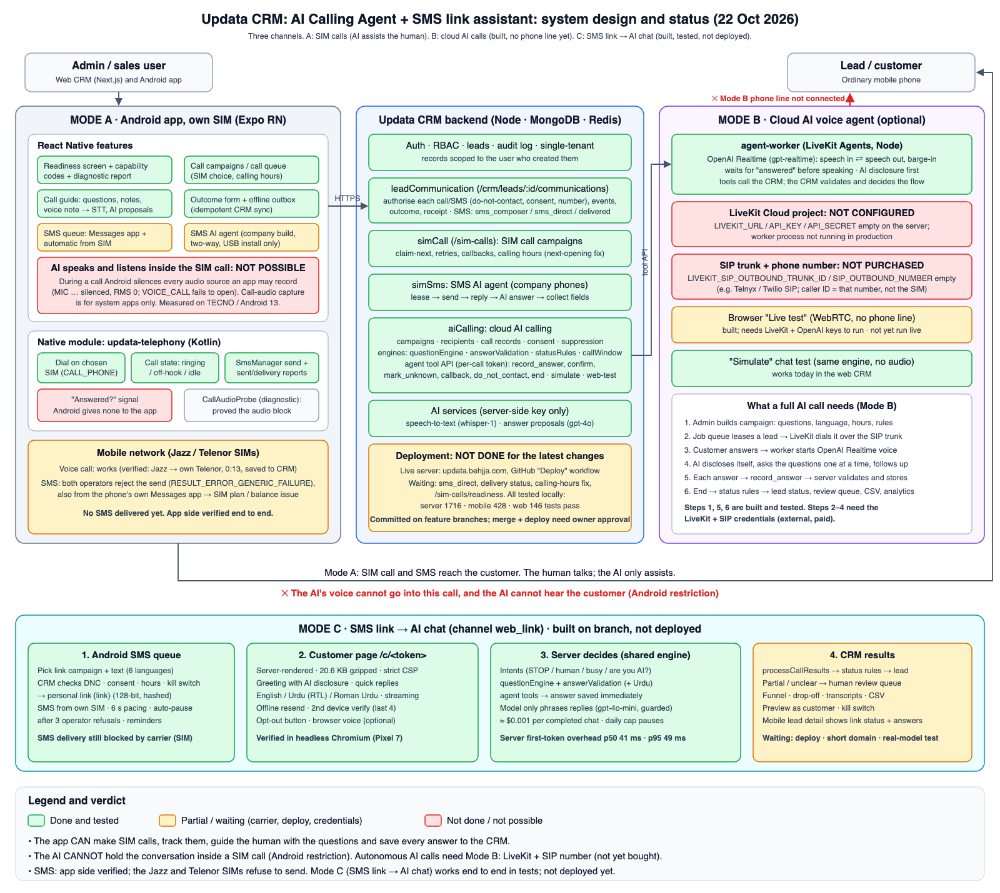
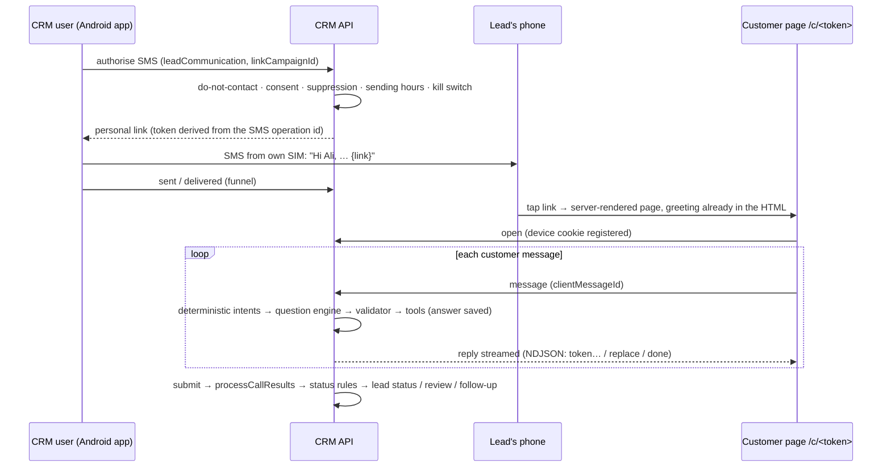

# SMS Link → AI Assistant

**Audience:** developers and operators of Updata CRM.
**Status (22 Oct 2026):** built and tested on branch `feature/sms-link-assistant`; **not deployed**. See §9 for what still needs the owner.

A CRM user texts each lead a **personal, secure link** from their own phone (the mobile SMS queue, automatic SIM sending or the Messages app). The link opens a fast, mobile-first chat page. An **AI assistant**:
- says in its first message that it is an AI;
- asks the campaign's questions one at a time;
- answers simple questions from the campaign FAQ;
- saves every validated answer to the CRM immediately.

It is the **`web_link` channel of the existing AI calling campaigns**. It reuses the same parts as AI calls:
- questionnaire, question engine, answer validation and status rules;
- review queue, consent and suppression checks;
- CSV export and lead outcome handling.

There is no second question or answer system.

---

## 1. How it works

### Who decides what

| Decision | Made by | Never by |
|---|---|---|
| Opt-out, "talk to a human", "are you human?", "I'm busy" | Deterministic keyword intents (English, Urdu, Roman Urdu), `engine/intents.js` | The model |
| Which question is next, re-asks, read-back, finish | `aiCalling/engine/questionEngine.js` | The model |
| Whether an answer is valid (type, format, allowed values) | `aiCalling/engine/answerValidation.js` (Urdu yes/no and "pata nahi" added) | The model. A model may *propose* a value for an unclear reply; it is re-validated, as for SMS replies (`simSms/engine/replyInterpreter.js`) |
| Lead status, review queue, callbacks, do-not-contact | `processCallResults` + status rules (as for calls). Incomplete sessions → review, never auto-qualified | The model |
| Wording of ordinary turns (ask, clarify, FAQ answer) | A low-cost text model, **streamed**. Output-checked: no human claims, no instruction leaks, no status claims. Otherwise a fixed text is used | n/a |
| Wording of safety turns (opt-out, hand-off, read-back, summary, thanks) | Fixed texts (`engine/assistantCopy.js`) | The model |

The model never receives tools or data it could change. The customer's text is wrapped as untrusted data.

### Conversation flow on the page

1. **Greeting** (pre-generated, instant). It contains the lead's name, the company, the reason for contact, "I'm *Ayesha*, an AI assistant from *Company*", the expected time ("about 3 minutes"), and the buttons *Yes, let's start* / *Not now* / *Don't contact me*.
2. **Questions one at a time:**
   - quick-reply buttons for choice and yes/no questions;
   - the matching keyboard for numbers, phone and email;
   - native pickers for dates and times;
   - a progress indicator ("2 of 6").
3. **Unclear answer:** one gentle re-ask, then the answer is recorded as *unknown* (never invented).
4. **Critical fields** (`confirmCritical`) are read back for confirmation.
5. **Customer questions** are answered **only from the FAQ**. Anything else is passed to the team as a notification and an open question on the session.
6. **Summary:** the lead can change any answer, then confirms. The session becomes read-only, and the results are processed into the CRM.
7. **Special cases:**
   - "I'm busy" → asks when to call → callback request.
   - "talk to a human" → follow-up notification, an optional note, an honest time frame.
   - "STOP" / "band karo" / "رابطہ نہ کریں" → do-not-contact (CRM lead status, call **and** SMS suppression) and the link closes.

---

## 2. Secure personal links

| Property | Implementation |
|---|---|
| Format | `https://<LINK_ASSISTANT_BASE_URL>/c/<token>`, token = 22 base62 characters (128 bits), no PII |
| Storage | Only an HMAC of the token (`LINK_ASSISTANT_TOKEN_SECRET`) is stored. The token for an SMS is HMAC-derived from the SMS operation id, so a retried authorisation returns the **same** link |
| Lifetime | `linkConfig.expiryDays` (default 7). Revocable from the CRM. Stops after opt-out |
| One conversation per lead and campaign | A reminder or resend adds a new token to the same open session; the lead continues where they left off |
| Devices | The first device to open the link is registered (httpOnly cookie, hash stored). A **second device** must enter the last 4 digits of the phone number before any saved answer is shown (5 tries, then locked for 1 h) |
| Link previews | WhatsApp, Facebook, Telegram and other preview bots get a neutral page and never count as an open |
| Funnel | `link_issued → sms_sent → delivered → link_opened → chat_started → completed / abandoned / opted_out / expired` |
| Rate limits | Per IP (page), per link + IP (messages), and a strict limit on **unknown links** that counts misses only |

---

## 3. SMS sending (mobile)

In "Text leads from your phone":
- choose a **link campaign** (optional);
- pick a ready-made text (English, Urdu, Roman Urdu, French, German, Arabic), or use the insert chips `{name} {city} {company} {link}`;
- see a preview with a real-length link, plus the character, encoding and segment count.

Warnings appear if `{link}` is missing. A text with `{link}` but no campaign cannot be sent, and the app never sends a raw `{link}`.

The CRM issues the link during the SMS authorisation, after the do-not-contact, consent and suppression checks plus **the campaign's sending hours and the kill switch**. If it can't, nothing is sent.

All existing protections apply:
- 1 SMS every 6 s per SIM, and a Stop button;
- delivery reports to the CRM;
- duplicate-send protection;
- the 12-hour skip;
- **automatic pause after 3 operator refusals in a row** ("check the SMS package or balance, or choose the other SIM").

**Reminders:** the server lists leads who are due a reminder (`GET /link-assistant/reminders/due`):
- only inside sending hours;
- at most `max`;
- never after opt-out or completion.

The Call Agent home shows "Send N reminder(s)", which opens the SMS queue in reminder mode. A reminder reuses the same conversation.

**Fallback to a human:** after the last reminder plus `afterHours`, the sweep adds the lead to the chosen **SIM call campaign** (`simCall.addLeads`), where a person calls.

**SMS length:** GSM texts (English, Roman Urdu, French, German) fit one SMS with the link. Urdu and Arabic are Unicode (70 characters per SMS), and a 128-bit link alone is 46–51 characters, so those texts take **2 SMS**. A short link domain helps but doesn't change this.

---

## 4. Customer page

| Requirement | Result |
|---|---|
| Server-rendered first screen, greeting in HTML | ✅ greeting is in the HTML response |
| Initial JS ≤ 150 KB gzipped | ✅ **20.6 KB** for HTML + CSS + JS (plain JS, no framework; fingerprinted, immutable, pre-gzipped) |
| First reply token p50 ≤ 800 ms, p95 ≤ 1.5 s | Server overhead measured: **p50 41 ms, p95 49 ms** (stub model, n=24). Real-model latency: run `node scripts/linkAssistantLatency.mjs --confirm` (paid; owner approval) |
| Streaming | NDJSON over `fetch` (token / replace / done), typing indicator |
| Lost connection | The message is kept locally and resent with the same id until delivered; the server answers each id once |
| Languages | English / Urdu (right-to-left) / Roman Urdu. Auto-detected from the first reply, switchable in one tap |
| Accessibility and trust | ≥ 44 px tap targets, font-size toggle, screen-reader labels, company initial and name, "automated assistant" note, privacy/terms links (`LINK_ASSISTANT_PRIVACY_URL`, `…_TERMS_URL`), "I don't want to be contacted" |
| Security | Strict CSP (`default-src 'none'`, self-only scripts and styles), no third-party scripts or trackers, `Referrer-Policy: no-referrer`, `noindex`, httpOnly SameSite cookie, `X-Requested-With` marker on every API call, `textContent` rendering only (no HTML from the server or customer) |
| Voice: browser tier | Push-to-talk speech recognition + "read replies aloud" where the browser supports it. Shown only when the campaign enables voice; falls back to text |
| Voice: premium tier (LiveKit + OpenAI Realtime) | **Not wired to the page yet.** The setting exists; the existing browser Live test covers the agent. Needs gate 3 (owner approval) and LiveKit keys |

---

## 5. Configuration

### Campaign (`linkConfig` on an AI calling campaign with `channel: 'web_link'`)

Edit these in the web CRM: **AI calling → New campaign → "SMS link → AI chat"**.

| Field | Default | Meaning |
|---|---|---|
| `personaName`, `personaTone` | Ayesha, warm | Name and tone of the assistant (the AI disclosure is not optional) |
| `reason` | "" | Why you are contacting them (first message) |
| `languages`, `defaultLanguage` | en, ur, roman_ur / en | Offered languages |
| `faq[]` | [] | The **only** facts the assistant may use to answer questions |
| `smsTemplates` | null | Per-language overrides of the default SMS texts |
| `expiryDays` | 7 | Link lifetime |
| `reminders` | off, 24 h, max 1 | Reminder SMS for unfinished chats |
| `fallbackToCall` | off | SIM call campaign for leads who never answer |
| `limits.maxTurns`, `maxSessionMinutes`, `maxTokensPerTurn` | 40, 30, 220 | Per-conversation limits (then politely ended → review) |
| `limits.dailySpendCap` | $2 | Model budget per campaign per UTC day. When reached, the campaign **pauses** (no new links), open chats continue with fixed texts, and the owner is notified |
| `voiceTier` | off | off / browser / premium |
| `transcriptRetentionDays` | 90 | Transcripts are purged after this |

Sending hours = the campaign's `schedule.callWindow` / `daysOfWeek` / `timezone`.

### Environment variables (server)

| Variable | Default | Purpose |
|---|---|---|
| `LINK_ASSISTANT_BASE_URL` | `PUBLIC_API_BASE_URL` | Origin used in links (a short domain later, gate 2) |
| `LINK_ASSISTANT_TOKEN_SECRET` | `JWT_SECRET` | HMAC key for tokens and devices (set a dedicated secret in production) |
| `LINK_ASSISTANT_ENABLED` | true | `false` = hard kill switch from the environment |
| `LINK_ASSISTANT_MODEL` | `gpt-4o-mini` | Low-cost text model (configurable; check current OpenAI models) |
| `LINK_ASSISTANT_PRICE_INPUT_PER_1M` / `_OUTPUT_PER_1M` | 0.15 / 0.60 | USD prices used for cost tracking and the cap |
| `LINK_ASSISTANT_COMPANY_NAME` | — | Fallback company name |
| `LINK_ASSISTANT_PRIVACY_URL`, `LINK_ASSISTANT_TERMS_URL` | — | Footer links |
| `OPENAI_API_KEY` | — | Without it, everything works with fixed texts (no model) |

### Kill switch

**Web CRM → AI calling → "Pause all (kill switch)"** (`ai-calling:admin`), or `LINK_ASSISTANT_ENABLED=false`. It stops all new links and AI turns immediately; open pages show a notice.

---

## 6. Cost per session (estimate)

| Item | Cost |
|---|---|
| SMS | From the SIM's package (1 SMS; 2 for Urdu/Arabic) |
| Model, per phrased turn | ≈ 480 prompt + 60 reply tokens ≈ **$0.00011** with gpt-4o-mini |
| Model, per completed 6-question chat | ≈ 7 phrased turns + ≤ 1 classification ≈ **$0.001** (≈ PKR 0.3) |
| Voice, browser tier | Free (the customer's browser) |
| Hosting | The existing API server |

Each session records its own token usage and cost (`usage.*`). The campaign analytics show "AI cost / completed".

---

## 7. API

**CRM** (`/api/v1/link-assistant`, auth + `ai-calling:*`):
- `GET settings`, `PUT settings/kill-switch` (admin);
- `GET templates?campaignId`;
- `GET sessions?campaignId&status&leadId`, `GET sessions/:id`, `POST sessions/:id/revoke`;
- `GET campaigns/:id/analytics`, `GET campaigns/:id/export` (CSV), `POST campaigns/:id/preview` ("Preview as customer");
- `GET reminders/due`, `GET leads/:leadId/sessions`.

Campaigns themselves: `/api/v1/ai-calling/campaigns` with `channel: 'web_link'`.

**SMS authorisation:** `POST /api/v1/crm/leads/:id/communications` with `linkCampaignId` (and `linkPurpose: reminder`) → `data.link.url`.

**Public** (`/c`, token only):
- `GET /c/:token` (page);
- `GET /c/assets/*`;
- `POST /c/:token/api/open | verify | language | message`;
- `GET /c/:token/api/state`.

**Metrics** (`/metrics`):
- `updata_link_assistant_events_total{event}`;
- `updata_link_assistant_turn_seconds{source}`;
- `updata_link_assistant_model_cost_total`.

**Jobs:** `link-assistant-sweep` every 10 min:
- expiry;
- abandoned after 24 h idle → partial → review;
- transcript purge;
- call fallback.

---

## 8. Tests

| Suite | What |
|---|---|
| `server/tests/unit/linkAssistant.engine.test.js` (39) | Tokens; intents in 3 languages incl. false positives; Urdu validation; templates and GSM/Unicode segments; model output guard; prompt rules; scripted customers: happy path, Roman Urdu/Urdu, unclear → unknown, "are you human?", opt-out, busy → callback, human hand-off, FAQ, **prompt injection ×3**, edit before submit, not now |
| `server/tests/unit/linkAssistant.api.test.js` (13) | HTTP end to end: authorise → link → open → chat → answers saved immediately → submit → lead qualified; streaming + cost + **daily cap pauses**; human-claim output replaced; opt-out → SMS suppression + link closed; **second device verify**; clientMessageId replay; expired/revoked/unknown/preview-bot; **kill switch**; sending hours; preview never touches the lead; CRM views + RBAC; abandoned → review; reminders |
| `server/tests/unit/linkAssistant.browser.test.js` (5) | **Real headless Chromium, Pixel 7**: full flow, numeric keyboard, ≥44 px targets, offline → reconnect (no duplicate), Urdu RTL + opt-out button, **page-weight budget**, **first-token latency p50/p95** |
| `mobile/src/features/linkAssistant/__tests__`, `communication/__tests__/contactFlows.test.ts` | `{link}` filled from the CRM; never sends a raw `{link}`; funnel stage; reminder grouping |
| `client/src/modules/aiCalling/__tests__/link-assistant-panel.test.tsx` (3) | Funnel and per-question table, transcript + revoke, "Preview as customer" |

---

## 9. Not done / needs the owner

| Item | Status | Next action |
|---|---|---|
| Deploy to the live server | **Waiting (gate 1)** | Review the PR, merge, run the "Deploy" workflow |
| Short link domain | **Waiting (gate 2)** | Choose a domain; point it at the API; set `LINK_ASSISTANT_BASE_URL` |
| Real-model latency numbers | **Not measured** (paid) | `node scripts/linkAssistantLatency.mjs --confirm` with your approval |
| Premium voice tier on the page | **Not built** (gate 3) | Approve LiveKit + OpenAI Realtime; then wire the existing agent-worker to link sessions |
| First real SMS batch | **Waiting (gate 4)** | Test on your own number first; the operator currently refuses SMS from both SIMs |
| "STOP" sent as an **SMS reply** | **Partial** | The client app cannot read SMS (no RECEIVE_SMS). Opt-out works on the page and via the company build's SMS agent. A reply in the Messages app is seen by the user, not the CRM |
| Invisible bot challenge | **Not built** | Only rate limits + "no JavaScript → no session" + preview-bot handling. A third-party challenge would add a tracker (excluded) |
| "Share via WhatsApp" | **Not built** (optional flag) | — |
| Language-model check of Urdu wording quality | **Not tested with a real model** | Review sample chats after enabling the model |
